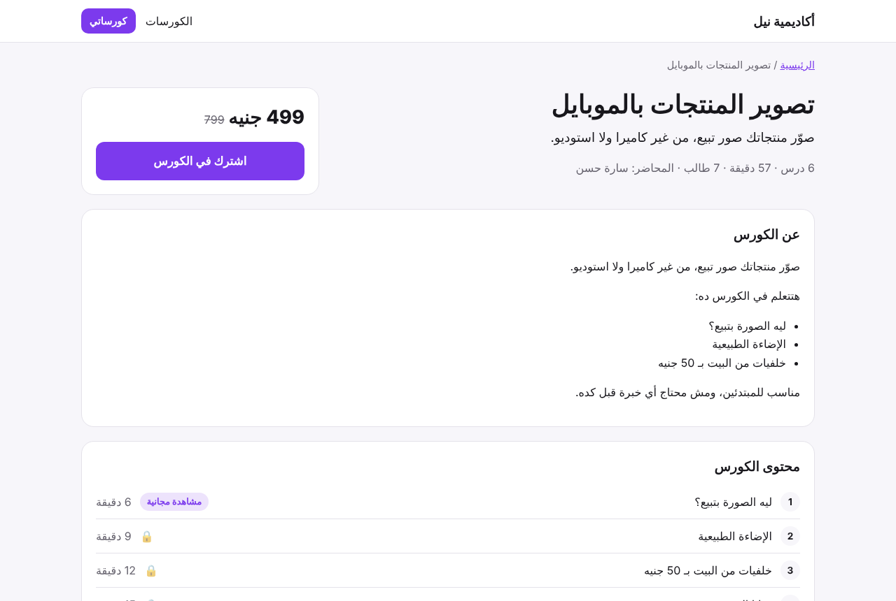
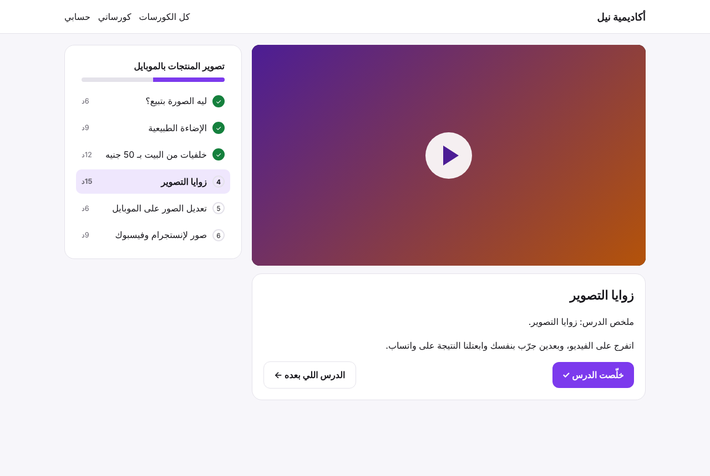
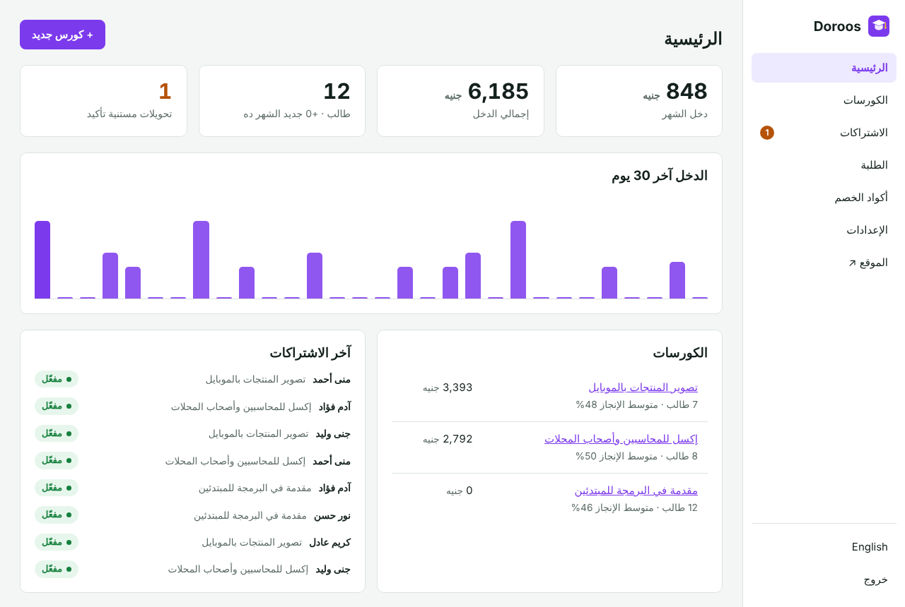
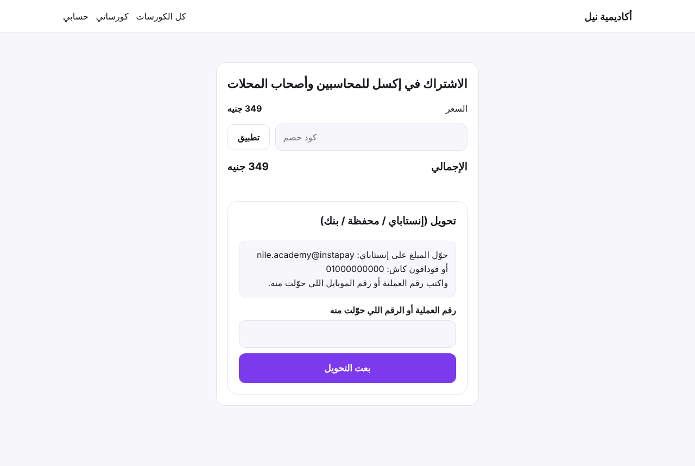
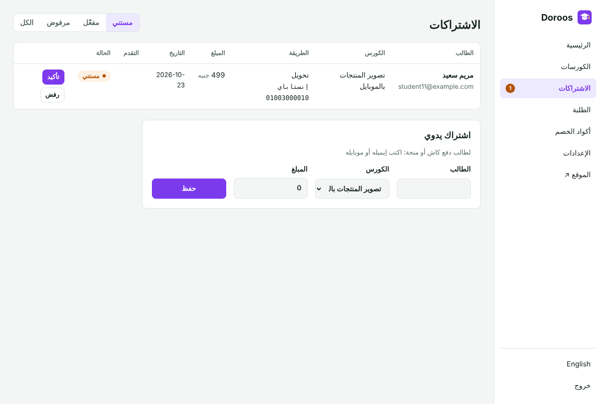

<div align="center">

# Doroos · دروس

**Sell your own online courses from your own website.**
For teachers, trainers, coaches and small academies. Course pages that show up on Google, student accounts, a clean lesson player with progress, payment by card (Stripe) or by bank or wallet transfer that you confirm, coupons, and videos from YouTube, Vimeo, Bunny, Google Drive or your own uploads. No monthly fee, no commission on your sales. Self-hosted, no dependencies.

[](https://www.hostinger.com/docker-hosting?compose_url=https://raw.githubusercontent.com/mashraf1997/doroos/main/docker-compose.yml&REFERRALCODE=YOUR_REFERRAL_CODE)

[English](#what-you-get) · [العربية](#بالعربي)



</div>

---

## What you get

**Your website**
- A home page listing your courses, and a page for each course with the description, the lessons, the price (with a "before" price if you like) and the number of students.
- Pages are rendered on the server with course structured data and a sitemap, so search engines and WhatsApp link previews see real content.
- Free preview lessons anyone can watch.

**For students**
- Sign up with an email or a mobile number.
- **My courses** with a progress bar for each.
- A lesson player with the video, your notes, the lesson list with check marks, **Mark as done** and **Next lesson**.
- Checkout with a coupon field, then card payment or transfer instructions with a field for the transfer reference.

**For you**
- Courses with a cover image, description, price and draft or published state. Lessons with a video, notes, length and free preview, reordered with arrows.
- **Videos:** paste a YouTube (unlisted), Vimeo, Bunny Stream or Google Drive link, or upload MP4 files. Uploaded videos only play for students who have access, with seeking support.
- **Enrollments:** confirm or reject transfers in one click, enroll someone by hand (cash, scholarship), and see each student's progress.
- **Payments:** Stripe Checkout with a signed webhook that opens the course automatically, and/or manual transfer (InstaPay, wallets, bank) that you confirm.
- **Coupons:** percent off, for one course or all, with a usage limit and an end date. 100% coupons make a course free for that student.
- **Dashboard:** revenue this month and in total, revenue per day, students, transfers to confirm, and per-course students, revenue and average completion.
- Students list with search, password reset and CSV export.
- Arabic and English, right-to-left ready.

<p align="center">
  
  
</p>
<p align="center">
  
  
</p>

## Deploy

**One click:** press **Deploy on Hostinger** above, open `http://YOUR-SERVER-IP/admin` and create your password. Put the site on your own domain with HTTPS before you take payments.

**Docker:**

```bash
git clone https://github.com/mashraf1997/doroos.git && cd doroos
docker compose up -d
```

**Node.js 20+:** `npm start` (no packages to install)

| Variable | Default | Purpose |
|---|---|---|
| `PORT` | `3000` | HTTP port |
| `DATA_DIR` | `./data` | Where `doroos.json` and uploaded media are stored. Back it up. |
| `SETUP_TOKEN` | *(empty)* | Required to create the first admin when set |
| `MAX_VIDEO_MB` | `2048` | Largest video upload in MB |
| `DEMO_MODE` | `false` | `true` makes this a public demo: sample academy, a reset every hour, and payments, video uploads and the password locked |
| `DEMO_PASSWORD` | `demo1234` | Password shown on the demo sign-in screen (demo students sign in with `student1@example.com` / `student1234`) |
| `DEMO_RESET_MINUTES` | `60` | How often the demo data resets (minimum 5) |
| `DEMO_LANG` | `ar` | Language of the sample data: `ar` or `en` |

### Card payments with Stripe

1. In **Settings → Payments**, paste your Stripe secret key and set the currency code (for example `USD` or `EGP`).
2. In the Stripe dashboard add a webhook to `https://your-domain/hooks/stripe` for `checkout.session.completed`, and paste its signing secret.
3. Students who pay by card get the course as soon as Stripe confirms the payment.

### Videos

Uploads are simple to start with. For many students or long videos, a video host (Bunny Stream, Vimeo, or unlisted YouTube) is lighter on your server and plays better on slow connections. Doroos only shows an uploaded video to students with access, but no website can stop a determined person from recording their screen.

## Development

```bash
npm test
```

No dependencies. No database server.

## More open-source tools

[Moallem](https://github.com/mashraf1997/moallem) (private tutor manager: groups, attendance, fees) · [Nashr](https://github.com/mashraf1997/nashr) (AI social posts) · [Wakeel](https://github.com/mashraf1997/wakeel) (AI WhatsApp assistant) · [Fatoora](https://github.com/mashraf1997/fatoora) (invoices)

## License

MIT

---

<div dir="rtl">

## بالعربي

**دروس** منصتك الخاصة لبيع الكورسات أونلاين من موقعك إنت. للمدرسين والمدربين والأكاديميات الصغيرة. صفحات للكورسات بتظهر في جوجل، حسابات للطلبة، مشغّل دروس بيتابع التقدم، دفع بالكارت أو تحويل (إنستاباي / محفظة / بنك) إنت بتأكده، أكواد خصم، وفيديوهات من يوتيوب أو فيميو أو Bunny أو جوجل درايف أو ترفعها بنفسك. من غير اشتراك شهري ومن غير عمولة على مبيعاتك.

- **موقعك:** صفحة رئيسية فيها الكورسات، وصفحة لكل كورس بالوصف والدروس والسعر، ودروس مجانية للتجربة.
- **للطالب:** حساب بالإيميل أو الموبايل، «كورساتي» بنسبة الإنجاز، ومشغّل فيه الفيديو والملخص وزرار «خلّصت الدرس».
- **ليك:** تضيف الكورسات والدروس، تأكد التحويلات بضغطة، تشترك طالب يدوي، تعمل أكواد خصم، وتشوف الدخل والطلبة ونسبة الإنجاز لكل كورس.
- **الفيديوهات المرفوعة** بتشتغل بس للطلبة المشتركين.

</div>
